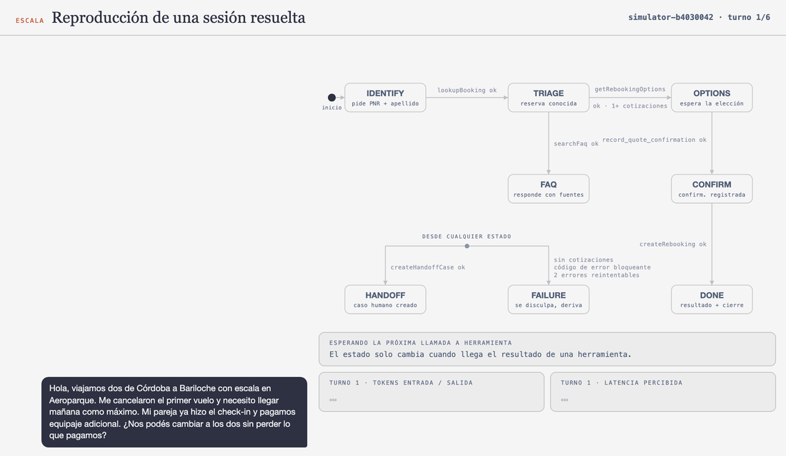
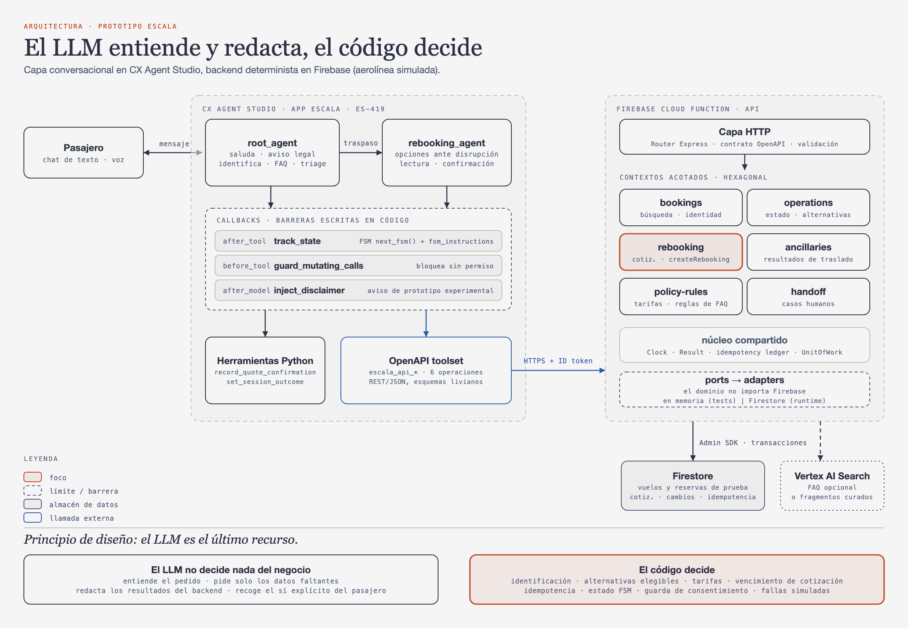
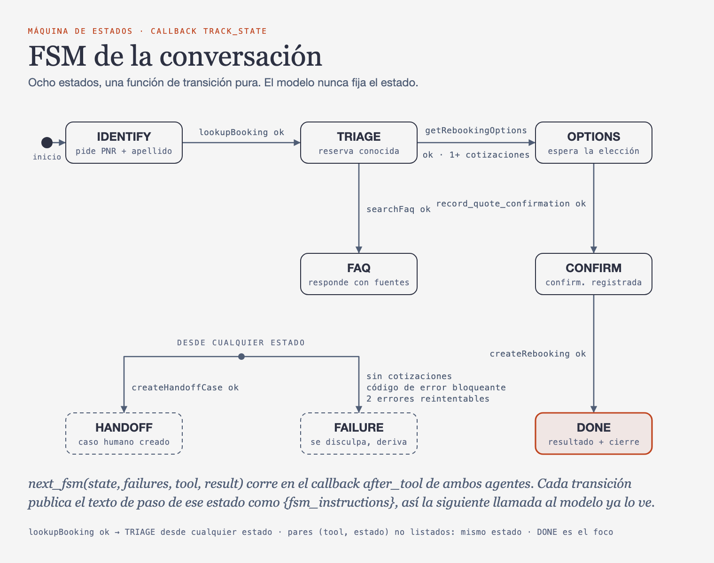
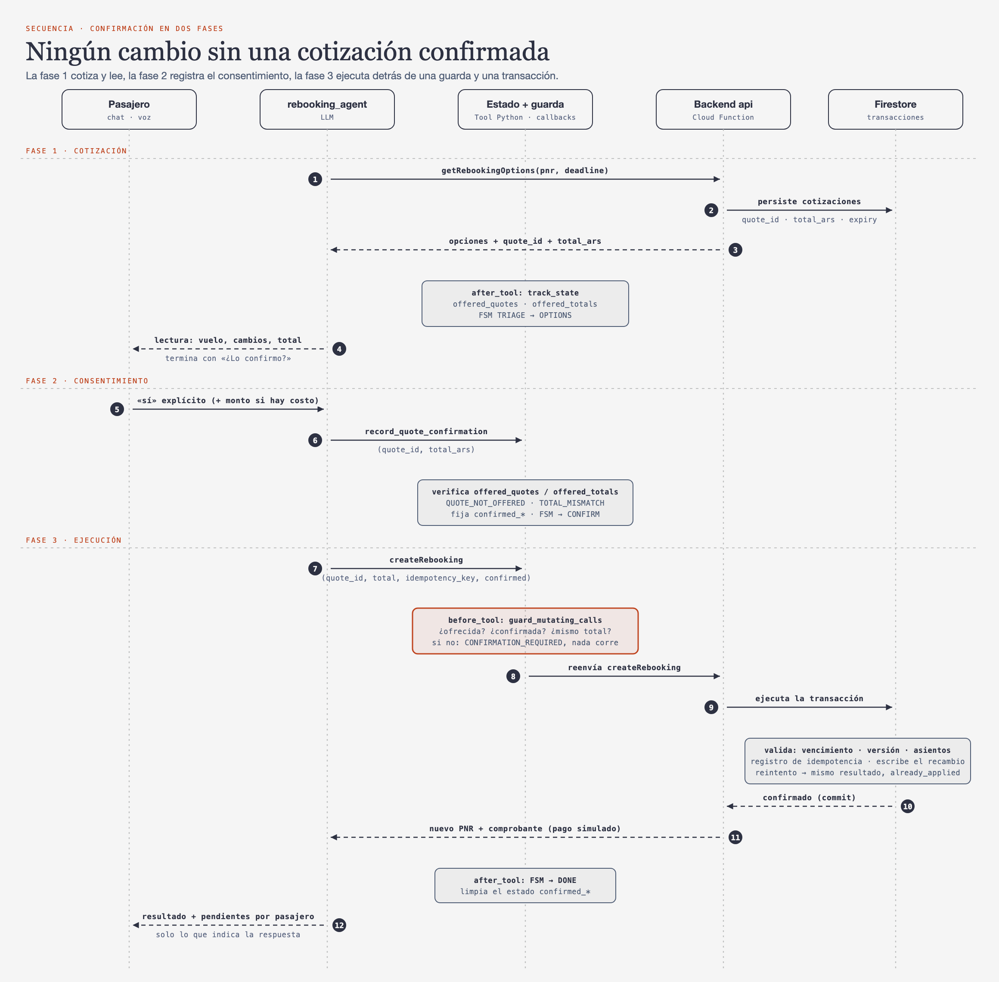

[English](README.md) | **Español**

# Escala

Un agente de voz y chat que reprograma a los pasajeros tras una disrupción de vuelo, construido sobre Google CX Agent Studio (CES/GECX) con un backend determinista en Firebase. El LLM entiende y redacta; el código decide. Cada paso de la conversación lo conduce una pequeña máquina de estados finitos (FSM), y ninguna reserva cambia hasta que el pasajero confirma la cotización exacta.



## Qué es esto

- Un **prototipo / demostración**. **No está afiliado a Aerolíneas Argentinas** ni a ninguna aerolínea. Todos los vuelos, reservas, precios y políticas son **simulados** (conjunto de datos sintético, sin integración real).
- El agente habla español (Argentina, voseo); este README está en español y el código está en inglés.
- Dos componentes desplegables: la app de CES (`escala/cxas_app/`) y un backend en Firebase (`escala/backend/`).

## El problema y el escenario de la demo

Un pasajero escribe: *"Hola, viajamos dos de Córdoba a Bariloche con escala en Aeroparque. Me cancelaron el primer vuelo y necesito llegar mañana como máximo. Mi pareja ya hizo el check-in y pagamos equipaje adicional. ¿Nos podés cambiar a los dos sin perder lo que pagamos?"*

Responder bien requiere datos que un LLM no debería adivinar: si todo el itinerario está afectado, qué alternativas llegan a tiempo *con asientos para ambos*, qué pasa con el equipaje extra, la selección de asientos y el check-in existente, y cuánto cuesta. El backend calcula todo eso; el agente lo explica y pide un sí explícito.

## Arquitectura



([versión SVG](docs/assets/architecture.es.svg))

**Principio de diseño: el LLM es el último recurso.** La identificación, las alternativas elegibles, las tarifas, el vencimiento de la cotización, la idempotencia, el estado de la conversación y la guarda de consentimiento son código. El modelo solo entiende el pedido, solicita el mínimo de datos faltantes, redacta los resultados del backend y obtiene la decisión del pasajero.

- `root_agent` saluda, muestra el aviso de prototipo, identifica la reserva y responde preguntas frecuentes; `disruption_rebooking_agent` se encarga de las opciones, la lectura y la confirmación.
- Un único toolset OpenAPI (`escala_api`) llama a una sola Cloud Function dividida en contextos acotados hexagonales (`bookings`, `operations`, `rebooking`, `ancillaries`, `policy-rules`, `handoff`). El código de dominio no importa Firebase; los adaptadores son en memoria para los tests y Firestore en runtime.
- Los callbacks (`track_state`, `guard_mutating_calls`, `inject_disclaimer`) mantienen las barreras de seguridad en código, no en los prompts.

## La FSM de la conversación



([versión SVG](docs/assets/fsm.es.svg))

El estado (`IDENTIFY, TRIAGE, FAQ, OPTIONS, CONFIRM, DONE, HANDOFF, FAILURE`) lo calcula una única función pura, `next_fsm(state, failures, tool, result)`, en el callback `after_tool`. El modelo nunca lo fija. Después de cada transición, el callback publica el **texto de paso del nuevo estado** como la variable `{fsm_instructions}`, de modo que el prompt del agente solo lleva las instrucciones del paso actual en lugar de todo el flujo.

Por qué importa (medido en el simulador de CES, ver [learnings](escala/docs/learnings.md)):

| | Antes | Después |
|---|---|---|
| Tokens de entrada por llamada al LLM | ~12k | ~2,5-7k (hasta 8k con payloads grandes de herramientas) |
| Esquema del toolset | ~5,8k tokens | ~1,3k tokens |

Dos detalles aprendidos a las malas: la variable de instrucciones debe actualizarse en `after_tool` (en `before_model` la solicitud ya está construida, lo que produce un desfase de una llamada), y un relleno del tipo "un momento por favor" emitido junto con una llamada a herramienta hace que el modelo devuelva una respuesta vacía, por eso no se instruyen rellenos.

El GIF del comienzo reproduce la sesión resuelta que sigue: el chat a la izquierda, la FSM a la derecha, la arista recién recorrida resaltada, con tokens y latencia por turno.

## Una conversación resuelta

Traza real de la sesión del simulador `simulator-b4030042` (6 turnos, 15 llamadas al LLM, 10 llamadas a herramientas, 19,2 s percibidos, 88.870 tokens de entrada). Los textos son los originales en español.

| # | Pasajero | Agente | Herramientas | Estado |
|---|---|---|---|---|
| 0 | "Hola, viajamos dos de Córdoba a Bariloche con escala en Aeroparque. Me cancelaron el primer vuelo y necesito llegar mañana como máximo. Mi pareja ya hizo el check-in y pagamos equipaje adicional. ¿Nos podés cambiar a los dos sin perder lo que pagamos?" | "Aviso: soy un asistente experimental de Escala, un prototipo que no está afiliado a Aerolíneas Argentinas. Los datos y los cambios son simulados." "Hola, lamento mucho la cancelación de tu vuelo... ¿me podrías pasar el código de reserva y el apellido de alguno de los pasajeros?" | `searchFaq` | IDENTIFY |
| 1 | "RMR4TX Romero" | "Tengo dos opciones disponibles para ustedes que llegan antes del límite de mañana. La opción A es un vuelo directo... saliendo a las nueve y quince... La opción B tiene escala en Aeroparque... ¿Cuál de las dos prefieren?" | `lookupBooking`, `transfer_to_agent`, `getRebookingOptions` | IDENTIFY → TRIAGE → OPTIONS |
| 2 | "La A" | "Para la opción A... el equipaje adicional de los dos se transfiere sin costo. Joaquín deberá realizar el check-in nuevamente... la selección de asientos no se mantiene... El cambio es sin costo, ¿lo confirmo?" | ninguna | OPTIONS |
| 3 | "Si es sin costo si, sino quiero una devolucion" | "El cambio ya fue realizado sin costo y el nuevo código de confirmación es K K U F W 5... Joaquín deberá volver a realizar el check-in... ¿Te puedo ayudar con algo más?" | `record_quote_confirmation`, `createRebooking` | OPTIONS → CONFIRM → DONE |
| 4 | "Si, sabemos en que puerta y cuando puedo hacer el check-in del nuevo vuelo?" | "La puerta de embarque todavía no está asignada para ese vuelo. El check-in online suele abrir entre veinticuatro y cuarenta y ocho horas antes... te sugiero confirmarlo en aerolineas.com.ar." | `getFlightStatus`, `searchFaq` | DONE |
| 5 | "no gracias" | (cierra la sesión) | `set_session_outcome`, `end_session` | DONE |

El turno 3 es el más interesante: la respuesta del pasajero fue condicional ("si es sin costo, sí"), la lectura indicó "sin costo" y el total de la cotización era 0, por lo que la confirmación es válida y se ejecuta `createRebooking`. Si el total hubiera sido mayor a cero, un simple "sí" habría exigido que el agente repitiera primero el monto.

## Seguridad: confirmación en dos fases



([versión SVG](docs/assets/confirmation-sequence.es.svg))

1. **Cotización**: `getRebookingOptions` almacena las cotizaciones (`quote_id`, total, vencimiento) en Firestore; el callback registra qué cotizaciones y totales se ofrecieron.
2. **Consentimiento**: tras la lectura y un sí explícito, `record_quote_confirmation` verifica la cotización y el total contra lo que se ofreció (`QUOTE_NOT_OFFERED`, `TOTAL_MISMATCH`).
3. **Guarda**: `guard_mutating_calls` (un callback `before_tool`) bloquea `createRebooking` salvo que la cotización confirmada, el indicador `confirmed=true` y el total coincidan. Es un cinturón de seguridad, ya que la herramienta de confirmación la invoca el propio LLM.
4. **El backend es la autoridad**: una transacción de Firestore revalida el vencimiento, la versión de la reserva y los asientos, y un registro de idempotencia hace que los reintentos devuelvan el mismo resultado (`already_applied`) en lugar de reservar dos veces.

## Pruebas

- `uv run pytest`: 39 tests offline (tests unitarios de callbacks, sincronización de la FSM entre los dos agentes, verificaciones del contrato OpenAPI/herramientas, lint, autotest del harness). Ver [TESTING.md](TESTING.md).
- `cd escala/backend/functions && npm test`: 221 tests de vitest (dominio y aplicación con adaptadores en memoria, más el generador de escenarios).
- `npm run test:integration`: adaptador de Firestore y tests HTTP contra el emulador de Firebase (requiere el CLI de Firebase).
- **Las evaluaciones de plataforma, las simulaciones y el LLM lint tienen costo y son opcionales.** Nunca se ejecutan por defecto (`@pytest.mark.billable`, se corren con `uv run pytest -m billable`).

## Estructura del repositorio

```
escala/
  sources/            PRD (en español) y decisiones fijas del proyecto
  tdd.md              documento de diseño técnico
  cxas_app/escala/    app de CES: agentes, callbacks, herramientas, toolset OpenAPI
  backend/            Firebase: functions/ (TypeScript, hexagonal), reglas de Firestore
  evals/              tests offline de callbacks y herramientas
  docs/               aprendizajes, guía de pruebas visuales
docs/
  assets/             diagramas, demo.gif y demo.es.gif (generados)
  tools/              scripts que regeneran los assets
.agents/skills/       skills de cxas-scrapi incluidas (Apache-2.0)
tests/ examples/      harness de tests offline y ejemplos del SDK
```

## Cómo ejecutarlo

Requisitos: Python 3.10+, [uv](https://docs.astral.sh/uv/), Node 22, CLI de Firebase y un proyecto de GCP con CX Agent Studio habilitado. Use sus propios valores para `<PROJECT_ID>`.

```bash
# Lado Python
.agents/skills/cxas-agent-foundry/scripts/setup.sh      # venv + SDK + configuración
uv run pytest                                            # tests offline

# Backend
cd escala/backend/functions && npm install && npm test
npm run seed:emulator                                    # carga datos en el emulador local
firebase deploy --only functions,firestore --project <PROJECT_ID>

# Cargar datos en un proyecto real (lista de permitidos opt-in, separada por comas)
SEED_ALLOWED_PROJECTS=<PROJECT_ID> node lib/seed/seed.js --project <PROJECT_ID> --reset

# App de CES (primero lint; el hook de pre-push solo corre si `cxas` está en el PATH)
uv run cxas lint --app-dir escala/cxas_app/escala
uv run cxas push --app-dir escala/cxas_app/escala --project-id <PROJECT_ID> --location us
```

Apunte la URL del servidor del toolset OpenAPI a tu función desplegada (la URL que imprime `firebase deploy`, en `servers:` de `escala/backend/functions/src/http/openapi.yaml`) y otorgue al agente de servicio de CES permiso para invocarla. Los ids de GCP incluidos en los archivos de configuración pertenecen al proyecto original y están protegidos por IAM; reemplácelos por los suyos.

Regenerar los diagramas y los GIF (inglés y español): `uv run --with playwright python docs/tools/build_assets.py` (la primera vez: `uv run --with playwright playwright install chromium`; `gifski` debe estar instalado). Para un solo idioma, agregue `en` o `es` al final. Los textos de cada idioma están en `docs/tools/i18n.py`.

## Aprendizajes clave

Destacados de [escala/docs/learnings.md](escala/docs/learnings.md): las cuotas de tokens de CES son por región física; `es-AR` no se acepta como código de idioma (usar `es-419`); los argumentos de las herramientas llegan como floats; los rellenos antes de llamadas a herramientas causan respuestas vacías; los fragmentos de FAQ pueden filtrarse en respuestas específicas de una reserva, por lo que los datos de la reserva deben venir solo de las respuestas de reservas. Las próximas palancas son respuestas del backend compactas pensadas para el agente y omitir la llamada a FAQ en los mensajes iniciales de disrupción.

## Créditos y licencias

- Código del proyecto (`escala/`, `docs/`): [MIT](LICENSE), Copyright (c) 2026 Fede Aletti.
- `.agents/skills/` y el harness del SDK provienen de [cxas-scrapi](https://github.com/GoogleCloudPlatform/cxas-scrapi) de Google y están licenciados bajo Apache License 2.0 ([`.agents/skills/LICENSE`](.agents/skills/LICENSE), [`NOTICE`](.agents/skills/NOTICE)).
- Estilo visual de los diagramas inspirado en [cathrynlavery/diagram-design](https://github.com/cathrynlavery/diagram-design) (MIT); los diagramas de este repositorio son SVG originales generados por `docs/tools/`.
- No está afiliado a Aerolíneas Argentinas. Los nombres de aerolíneas aparecen solo como inspiración del escenario.
