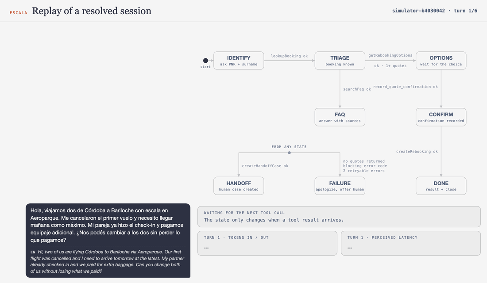
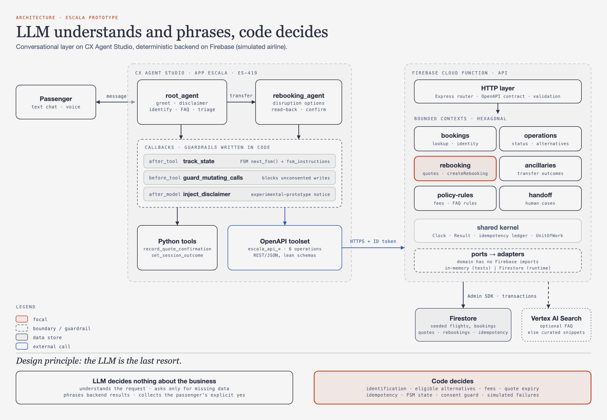
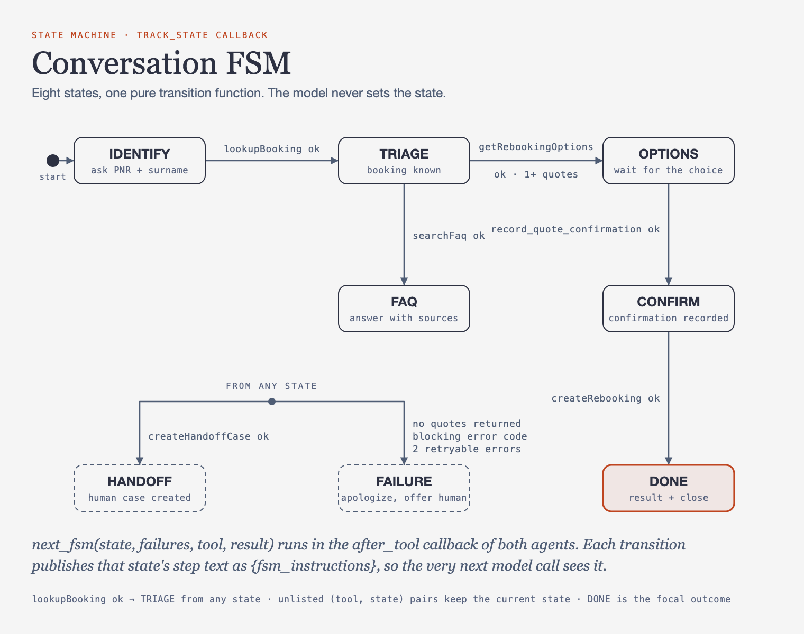
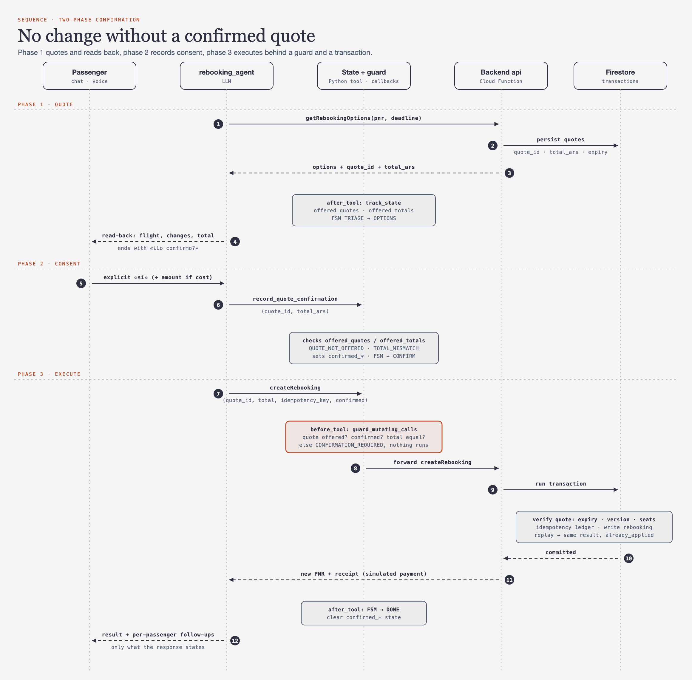

**English** | [Español](README.es.md)

# Escala

A voice and chat agent that rebooks passengers after a flight disruption, built on Google CX Agent Studio (CES/GECX) with a deterministic Firebase backend. The LLM understands and phrases; code decides. Every conversation step is driven by a small finite-state machine, and no booking changes until the passenger has confirmed the exact quote.



## What this is

- A **prototype / showcase**. It is **not affiliated with Aerolíneas Argentinas** or any airline. All flights, bookings, prices and policies are **simulated** (synthetic dataset, no real integration).
- The agent speaks Spanish (Argentina, voseo); this README and the code are in English.
- Two deployables: the CES app (`escala/cxas_app/`) and a Firebase backend (`escala/backend/`).

## The problem and the demo scenario

A passenger writes: *"Two of us fly Córdoba to Bariloche via Aeroparque. They cancelled our first flight, I need to arrive tomorrow at the latest, my partner already checked in and we paid for extra baggage. Can you change both of us without losing what we paid?"*

Answering correctly needs facts an LLM should not guess: is the whole itinerary affected, which alternatives reach the deadline *with seats for both*, what happens to the extra bags, the seat selection and the existing check-in, and what it costs. The backend computes all of that; the agent explains it and asks for an explicit yes.

## Architecture



([SVG version](docs/assets/architecture.svg))

**Design principle: the LLM is the last resort.** Identification, eligible alternatives, fees, quote expiry, idempotency, the conversation state and the consent guard are code. The model only understands the request, asks for the minimum missing data, phrases backend results and gets the passenger's decision.

- `root_agent` greets, shows the prototype disclaimer, identifies the booking and answers FAQs; `disruption_rebooking_agent` owns options, read-back and confirmation.
- One OpenAPI toolset (`escala_api`) calls a single Cloud Function split into hexagonal bounded contexts (`bookings`, `operations`, `rebooking`, `ancillaries`, `policy-rules`, `handoff`). Domain code has no Firebase imports; adapters are in-memory for tests and Firestore at runtime.
- Callbacks (`track_state`, `guard_mutating_calls`, `inject_disclaimer`) hold the guardrails in code, not in prompts.

## The conversation FSM



([SVG version](docs/assets/fsm.svg))

The state (`IDENTIFY, TRIAGE, FAQ, OPTIONS, CONFIRM, DONE, HANDOFF, FAILURE`) is computed by one pure function, `next_fsm(state, failures, tool, result)`, in the `after_tool` callback. The model never sets it. After each transition the callback publishes the **step text of the new state** as the `{fsm_instructions}` variable, so the agent prompt only carries the instructions for the current step instead of the whole flow.

Why it matters (measured on the CES simulator, see [learnings](escala/docs/learnings.md)):

| | Before | After |
|---|---|---|
| Input tokens per LLM call | ~12k | ~2.5-7k (up to 8k with large tool payloads) |
| Toolset schema | ~5.8k tokens | ~1.3k tokens |

Two details learned the hard way: the instruction variable must be updated in `after_tool` (in `before_model` the request is already built, which gives a one-call lag), and a "one moment please" filler emitted alongside a tool call makes the model return an empty reply, so fillers are not instructed.

The GIF at the top replays the resolved session below: chat left, FSM right, the edge just taken highlighted, with per-turn tokens and latency.

## A resolved conversation

Real trace of simulator session `simulator-b4030042` (6 turns, 15 LLM calls, 10 tool calls, 19.2 s perceived, 88,870 input tokens). The agent's text is Spanish; glosses are mine.

| # | Passenger | Agent (Spanish) | English gloss | Tools | State |
|---|---|---|---|---|---|
| 0 | Hi, two of us Córdoba to Bariloche... cancelled first flight, arrive tomorrow, partner checked in, extra baggage. Can you change both without losing what we paid? | "Aviso: soy un asistente experimental de Escala, un prototipo que no está afiliado a Aerolíneas Argentinas. Los datos y los cambios son simulados." "Hola, lamento mucho la cancelación de tu vuelo... ¿me podrías pasar el código de reserva y el apellido de alguno de los pasajeros?" | Experimental-prototype notice, apology, asks for booking code and a surname. | `searchFaq` | IDENTIFY |
| 1 | "RMR4TX Romero" | "Tengo dos opciones disponibles para ustedes que llegan antes del límite de mañana. La opción A es un vuelo directo... saliendo a las nueve y quince... La opción B tiene escala en Aeroparque... ¿Cuál de las dos prefieren?" | Two options that meet the deadline: A direct 09:15-11:40, B via Aeroparque 07:00-12:05. Which one? | `lookupBooking`, `transfer_to_agent`, `getRebookingOptions` | IDENTIFY → TRIAGE → OPTIONS |
| 2 | "La A" | "Para la opción A... el equipaje adicional de los dos se transfiere sin costo. Joaquín deberá realizar el check-in nuevamente... la selección de asientos no se mantiene... El cambio es sin costo, ¿lo confirmo?" | Bags transfer free; Joaquín must redo check-in; seats are not kept (a human handles the refund); free of charge, confirm? | none | OPTIONS |
| 3 | "Si es sin costo si, sino quiero una devolucion" (if it's free, yes; otherwise I want a refund) | "El cambio ya fue realizado sin costo y el nuevo código de confirmación es K K U F W 5... Joaquín deberá volver a realizar el check-in... ¿Te puedo ayudar con algo más?" | Done at no cost, new code, receipt, remaining follow-up. | `record_quote_confirmation`, `createRebooking` | OPTIONS → CONFIRM → DONE |
| 4 | "Si, sabemos en que puerta y cuando puedo hacer el check-in del nuevo vuelo?" | "La puerta de embarque todavía no está asignada para ese vuelo. El check-in online suele abrir entre veinticuatro y cuarenta y ocho horas antes... te sugiero confirmarlo en aerolineas.com.ar." | Gate not assigned yet; check-in usually opens 24-48 h before; confirm on the airline site. | `getFlightStatus`, `searchFaq` | DONE |
| 5 | "no gracias" | (closes the session) | Outcome set to `resolved`, session ended. | `set_session_outcome`, `end_session` | DONE |

Turn 3 is the interesting one: the passenger's answer was conditional ("if it's free, yes"), the read-back stated "sin costo", and the total of the quote was 0, so the confirmation is valid and `createRebooking` runs. Had the total been above zero, a bare "yes" would have required the agent to repeat the amount first.

## Safety: two-phase confirmation



([SVG version](docs/assets/confirmation-sequence.svg))

1. **Quote**: `getRebookingOptions` stores quotes (`quote_id`, total, expiry) in Firestore; the callback records which quotes and totals were offered.
2. **Consent**: after the read-back and an explicit yes, `record_quote_confirmation` checks the quote and total against what was offered (`QUOTE_NOT_OFFERED`, `TOTAL_MISMATCH`).
3. **Guard**: `guard_mutating_calls` (a `before_tool` callback) blocks `createRebooking` unless the confirmed quote, a `confirmed=true` flag and the total all match. It is a seatbelt, since the confirmation tool is itself LLM-called.
4. **Backend is authoritative**: a Firestore transaction re-validates expiry, booking version and seats, and an idempotency ledger makes retries return the same result (`already_applied`) instead of booking twice.

## Testing

- `uv run pytest`: 39 offline tests (callback unit tests, FSM sync between the two agents, OpenAPI/tool contract checks, lint, harness self-test). See [TESTING.md](TESTING.md).
- `cd escala/backend/functions && npm test`: 221 vitest tests (domain and application with in-memory adapters, plus the scenario generator).
- `npm run test:integration`: Firestore adapter and HTTP tests against the Firebase emulator (needs the Firebase CLI).
- **Platform evals, simulations and LLM lint are billable and opt-in.** They are never run by default (`@pytest.mark.billable`, run with `uv run pytest -m billable`).

## Repository layout

```
escala/
  sources/            PRD (Spanish) and fixed project decisions
  tdd.md              technical design document
  cxas_app/escala/    CES app: agents, callbacks, tools, OpenAPI toolset
  backend/            Firebase: functions/ (TypeScript, hexagonal), firestore rules
  evals/              offline callback and tool tests
  docs/               learnings, visual test guide
docs/
  assets/             diagrams, demo.gif (generated)
  tools/              scripts that regenerate the assets
.agents/skills/       vendored cxas-scrapi skills (Apache-2.0)
tests/ examples/      offline test harness and SDK examples
```

## How to run

Prerequisites: Python 3.10+, [uv](https://docs.astral.sh/uv/), Node 22, Firebase CLI, a GCP project with CX Agent Studio enabled. Use your own values for `<PROJECT_ID>`.

```bash
# Python side
.agents/skills/cxas-agent-foundry/scripts/setup.sh      # venv + SDK + config
uv run pytest                                            # offline tests

# Backend
cd escala/backend/functions && npm install && npm test
npm run seed:emulator                                    # seed the local emulator
firebase deploy --only functions,firestore --project <PROJECT_ID>

# Seed a real project (opt-in allowlist, comma-separated)
SEED_ALLOWED_PROJECTS=<PROJECT_ID> node lib/seed/seed.js --project <PROJECT_ID> --reset

# CES app (lint first; the pre-push hook only runs if `cxas` is on PATH)
uv run cxas lint --app-dir escala/cxas_app/escala
uv run cxas push --app-dir escala/cxas_app/escala --project-id <PROJECT_ID> --location us
```

Point the OpenAPI toolset server URL at your deployed function (the URL printed by `firebase deploy`, in `servers:` of `escala/backend/functions/src/http/openapi.yaml`) and grant the CES service agent permission to invoke it. The GCP ids committed in config files belong to the original project and are IAM-protected; replace them with yours.

Regenerate the diagrams and the GIF: `uv run --with playwright python docs/tools/build_assets.py` (first time: `uv run --with playwright playwright install chromium`; `gifski` must be installed).

## Key learnings

Highlights from [escala/docs/learnings.md](escala/docs/learnings.md): CES token quotas are per physical region; `es-AR` is not accepted as a language code (use `es-419`); tool arguments arrive as floats; fillers before tool calls cause empty replies; FAQ snippets can leak into booking-specific answers, so booking facts must come only from booking responses. Next levers are compact agent-facing backend responses and skipping the FAQ call on disruption openers.

## Credits and licenses

- Project code (`escala/`, `docs/`): [MIT](LICENSE), Copyright (c) 2026 Fede Aletti.
- `.agents/skills/` and the SDK harness come from Google's [cxas-scrapi](https://github.com/GoogleCloudPlatform/cxas-scrapi) and are licensed under the Apache License 2.0 ([`.agents/skills/LICENSE`](.agents/skills/LICENSE), [`NOTICE`](.agents/skills/NOTICE)).
- Diagram visual style inspired by [cathrynlavery/diagram-design](https://github.com/cathrynlavery/diagram-design) (MIT); the diagrams here are original SVGs generated by `docs/tools/`.
- Not affiliated with Aerolíneas Argentinas. Airline names appear only as the scenario's inspiration.
